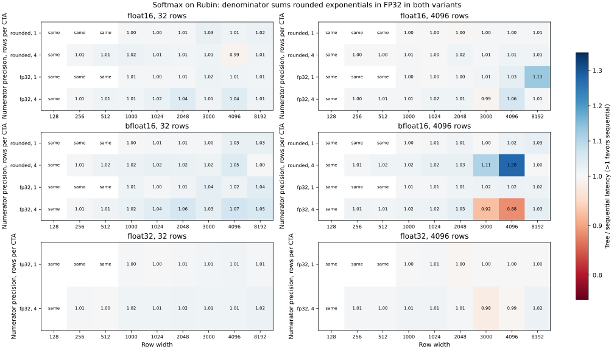

# Rubin reduction benchmark

Measured on Rubin (SM 10.7, 216 SMs), using compiler commit
`da2c3c079f90fad9c75a72f426f4bc860d4a6e08`. The suite includes 606 sum
cases and 180 softmax cases. All numerical checks passed; neither policy spilled
registers in any measured case. These measurements are from one GPU, with hot
inputs and no clock locking.

The paired policies use identical input/output pointers, layouts, launch
parameters, and numerical precision. See the [benchmark methodology](../reduction.md)
and [benchmark source](../reduction.py). The example table reports latency
reduction: `100 × (tree − sequential) / tree`. Positive percentages favor
sequential; negative percentages indicate a regression. Aggregate statistics
and plots use the tree/sequential latency ratio (×), where values above one
favor sequential.

Sum labels specify input and accumulation precision: **FP16→FP32** and
**BF16→FP32** are mixed-precision reductions, while **FP32→FP32** uses FP32
throughout. Softmax dtype labels describe its input/output dtype; its
denominator is always accumulated in FP32.

Reproduce the full sweep and selected examples from the repository root:

```sh
python python/test/microbenchmark/reduction.py --suite full --output /tmp/reduction-full --dump-code
python python/test/microbenchmark/reduction.py --suite full --case-ids 189,190,191,382,510,542,574,670,671,672,673,674,675 --repeats 11 --rep-ms 20 --output /tmp/reduction-rerun
python python/test/microbenchmark/reduction.py --suite full --case-ids 740,741,744,745 --repeats 11 --rep-ms 20 --output /tmp/reduction-bf16-rerun
```

## Selected cases rerun with longer measurements

After the full sweep, 17 selected cases were rerun in separate benchmark invocations
on the same GPU, using the same implementation. These reruns used 11 measurement
rounds of approximately 20 ms per policy, compared with 5 rounds of approximately
10 ms in the full sweep. The table shows 7 examples from the 17 rerun
configurations, using the longer measurements. Case IDs identify configurations
in the full 786-case sweep and can be passed to `--case-ids`; all 17 rerun
configurations are included in the linked rerun CSVs.

| Case ID | Workload | Tree (µs) | Sequential (µs) | Latency reduction (%) | Mixed adds tree/seq | Registers tree/seq |
|---|---|---:|---:|---:|---:|---:|
| 190 | FP16→FP32 sum, one CTA, 4×16384, output packing | 5.917 | 4.027 | +31.9% | 128/254 | 84/64 |
| 191 | FP16→FP32 sum, 432 CTAs, 4×16384 per CTA, output packing | 7.064 | 5.159 | +27.0% | 128/254 | 84/64 |
| 510 | FP32→FP32 sum, one CTA, 16×4096, output packing | 3.124 | 3.653 | -16.9% | 0/0 | 164/64 |
| 542 | FP32→FP32 sum, one CTA, 4×16384, reduction packing | 4.766 | 3.389 | +28.9% | 0/0 | 64/64 |
| 675 | FP16 softmax 4096×8192, FP32 numerator, one row per CTA | 18.358 | 16.285 | +11.3% | 8/15 | 68/62 |
| 744 | BF16 softmax 4096×4096, rounded numerator, four rows per CTA | 10.098 | 7.919 | +21.6% | 0/0 | 195/154 |
| 745 | BF16 softmax 4096×4096, FP32 numerator, four rows per CTA | 7.655 | 8.665 | -13.2% | 32/63 | 166/177 |

Sequential scheduling has a practical softmax benefit, but it is not universal. The FP16 FP32-numerator case emits 8 mixed adds with tree scheduling and 15 with sequential. Reusing widened rounded exponentials prevents that folding in this benchmark. The BF16 rounded-numerator win has no mixed adds at all, and its register count drops from 195 to 154; a related FP32-numerator case regresses despite emitting more mixed adds. Instruction count alone is therefore insufficient to predict performance.

These measurements compare policies within each numerical variant. They do not establish that a mixed-precision softmax is faster than every alternative implementation. In particular, the FP16 FP32-numerator variant above remains slower than the rounded-numerator variant at the same shape (16.078 / 15.971 us for tree / sequential).

The regressions rule out universally switching all sums to sequential. They do not rule out a narrower target/layout heuristic. These are Rubin measurements; no cross-architecture claim is made.

[Main reruns](rerun-main.csv) · [BF16 reruns](rerun-bf16.csv)

786 paired cases: 606 sums and 180 softmaxes. All numerical checks passed. No register spills.

The aggregate table uses tree/sequential latency ratios (×). Identical-PTX controls are excluded.
The ratio thresholds are descriptive, not significance tests. Timings include loads and stores.

| Workload | Sum input→accumulation / softmax dtype | Cases with different PTX | Geomean ratio (×) | Ratio range (×) | Ratio >1.03× | Ratio <1/1.03× |
|---|---|---:|---:|---:|---:|---:|
| sum | FP16→FP32 | 158 | 1.017 | 0.943–1.473 | 21 | 3 |
| sum | BF16→FP32 | 158 | 1.018 | 0.942–1.448 | 21 | 2 |
| sum | FP32→FP32 | 158 | 1.006 | 0.856–1.410 | 12 | 6 |
| softmax | float16 | 56 | 1.013 | 0.991–1.130 | 5 | 0 |
| softmax | bfloat16 | 56 | 1.021 | 0.885–1.276 | 12 | 2 |
| softmax | float32 | 28 | 1.007 | 0.981–1.020 | 0 | 0 |

## FP32→FP32 sums

There are 202 FP32-input / FP32-accumulation sum cases. Of the 158 with different
PTX, 12 have a tree/sequential ratio above 1.03× and 6 below 1/1.03×. The
geometric-mean ratio across those 158 cases is 1.006×: most cases are near parity.

Case 542's longer-measurement rerun improves by 1.406× with 64 registers in
both variants, no spills, and no mixed-precision adds. In the full sweep, the
same 4×16384 tile improves from 14.975 to 10.980 µs (1.364×) with 432 CTAs
(case 543). That saturated-grid case was not rerun with longer measurements. The
one-CTA case 510 instead regresses from 3.124 to 3.653 µs (0.855×).

Thus pure FP32 can benefit too, but the gain is layout-dependent and cannot be
attributed to mixed-precision folding. Explaining the precise mechanism would
require further SASS/scheduling analysis.

## Plots

Gray cells marked “same” have identical PTX.




## Raw data

- [All results](results.csv)
- [Timing samples for all runs](timing-samples.csv)
- [Environment and benchmark source hash](results-metadata.json)
- Rerun environments: [main](rerun-main-metadata.json), [BF16](rerun-bf16-metadata.json)

Softmax has two explicitly labeled numerical variants. “rounded” reuses widened rounded exponentials for normalization; “fp32” retains the original FP32 exponentials as the numerator. Both round before the denominator sum. Thus neither low-precision variant is a fully FP32 softmax.

Do not attribute timing differences in identical-PTX controls to scheduling. One-CTA microsecond-scale measurements can show launch/scheduling effects even when their within-run samples are tight. Selected nontrivial cases are repeated separately before being quoted as examples.
