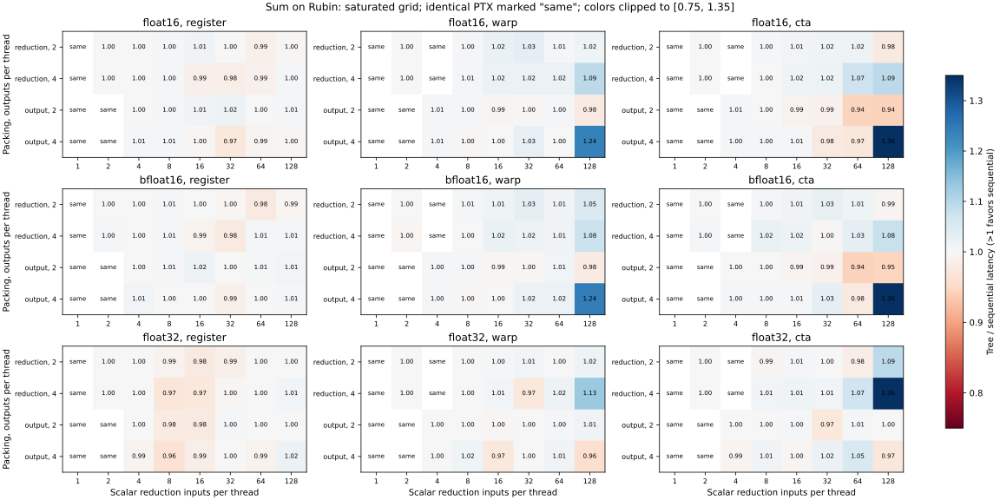
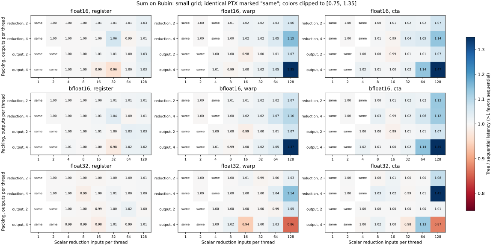

# Rubin reduction benchmark

Measured on Rubin (SM 10.7, 216 SMs), using compiler commit
`da2c3c079f90fad9c75a72f426f4bc860d4a6e08`. The suite includes 606 sum
cases and 180 softmax cases. All numerical checks passed; neither policy spilled
registers in any measured case. These measurements are from one GPU, with hot
inputs and no clock locking.

The paired policies use identical input/output pointers, layouts, launch
parameters, and numerical precision. See the [benchmark methodology](../reduction.md)
and [benchmark source](../reduction.py). Speedup is tree latency divided by
sequential latency; values above one favor sequential.

Reproduce the full sweep and selected examples from the repository root:

```sh
python python/test/microbenchmark/reduction.py --suite full --output /tmp/reduction-full --dump-code
python python/test/microbenchmark/reduction.py --suite full --case-ids 189,190,191,382,510,542,574,670,671,672,673,674,675 --repeats 11 --rep-ms 20 --output /tmp/reduction-rerun
python python/test/microbenchmark/reduction.py --suite full --case-ids 740,741,744,745 --repeats 11 --rep-ms 20 --output /tmp/reduction-bf16-rerun
```

## Independently repeated examples

17 selected cases were repeated with 11 rounds of 20 ms per policy. The examples below use those reruns.

| Case | Workload | Tree us | Sequential us | Speedup | Mixed adds tree/seq | Registers tree/seq |
|---|---|---:|---:|---:|---:|---:|
| 190 | FP16 sum, one CTA, 4×16384, output packing | 5.917 | 4.027 | 1.469 | 128/254 | 84/64 |
| 191 | FP16 sum, 432 CTAs, 4×16384 per CTA, output packing | 7.064 | 5.159 | 1.369 | 128/254 | 84/64 |
| 510 | FP32 sum, one CTA, 16×4096, output packing | 3.124 | 3.653 | 0.855 | 0/0 | 164/64 |
| 542 | FP32 sum, one CTA, 4×16384, reduction packing | 4.766 | 3.389 | 1.406 | 0/0 | 64/64 |
| 675 | FP16 softmax 4096×8192, FP32 numerator, one row per CTA | 18.358 | 16.285 | 1.127 | 8/15 | 68/62 |
| 744 | BF16 softmax 4096×4096, rounded numerator, four rows per CTA | 10.098 | 7.919 | 1.275 | 0/0 | 195/154 |
| 745 | BF16 softmax 4096×4096, FP32 numerator, four rows per CTA | 7.655 | 8.665 | 0.883 | 32/63 | 166/177 |

Sequential scheduling has a practical softmax benefit, but it is not universal. The FP16 FP32-numerator case emits 8 mixed adds with tree scheduling and 15 with sequential. Reusing widened rounded exponentials prevents that folding in this benchmark. The BF16 rounded-numerator win has no mixed adds at all, and its register count drops from 195 to 154; a related FP32-numerator case regresses despite emitting more mixed adds. Instruction count alone is therefore insufficient to predict performance.

These measurements compare policies within each numerical variant. They do not establish that a mixed-precision softmax is faster than every alternative implementation. In particular, the FP16 FP32-numerator variant above remains slower than the rounded-numerator variant at the same shape (16.078 / 15.971 us for tree / sequential).

The regressions rule out universally switching all sums to sequential. They do not rule out a narrower target/layout heuristic. These are Rubin measurements; no cross-architecture claim is made.

[Main reruns](rerun-main.csv) · [BF16 reruns](rerun-bf16.csv)

786 paired cases: 606 sums and 180 softmaxes. All numerical checks passed. No register spills.

Speedup is tree latency / sequential latency. Identical-PTX controls are excluded from the table below.
The 3% threshold is descriptive, not a significance test. Timings include loads and stores.

| Workload | Type | Cases with different PTX | Geomean | Range | >3% faster | >3% slower |
|---|---|---:|---:|---:|---:|---:|
| sum | float16 | 158 | 1.017 | 0.943–1.473 | 21 | 3 |
| sum | bfloat16 | 158 | 1.018 | 0.942–1.448 | 21 | 2 |
| sum | float32 | 158 | 1.006 | 0.856–1.410 | 12 | 6 |
| softmax | float16 | 56 | 1.013 | 0.991–1.130 | 5 | 0 |
| softmax | bfloat16 | 56 | 1.021 | 0.885–1.276 | 12 | 2 |
| softmax | float32 | 28 | 1.007 | 0.981–1.020 | 0 | 0 |

## Pure FP32 sums

There are 202 FP32-input / FP32-accumulation sum cases. Of the 158 with different
PTX, 12 improve by more than 3% and 6 regress by more than 3%. The geometric-mean
speedup across those 158 cases is 1.006×: most cases are near parity.

The independently repeated case 542 improves by 1.406× with 64 registers in
both variants, no spills, and no mixed-precision adds. In the full sweep, the
same 4×16384 tile improves from 14.975 to 10.980 µs (1.364×) with 432 CTAs
(case 543). That saturated-grid case was not independently repeated. The
one-CTA case 510 instead regresses from 3.124 to 3.653 µs (0.855×).

Thus pure FP32 can benefit too, but the gain is layout-dependent and cannot be
attributed to mixed-precision folding. Explaining the precise mechanism would
require further SASS/scheduling analysis.

## Plots

Gray cells marked “same” have identical PTX.






## Raw data

- [All results](results.csv)
- [Timing samples for all runs](timing-samples.csv)
- [Environment and benchmark source hash](results-metadata.json)
- Rerun environments: [main](rerun-main-metadata.json), [BF16](rerun-bf16-metadata.json)

Softmax has two explicitly labeled numerical variants. “rounded” reuses widened rounded exponentials for normalization; “fp32” retains the original FP32 exponentials as the numerator. Both round before the denominator sum. Thus neither low-precision variant is a fully FP32 softmax.

Do not attribute timing differences in identical-PTX controls to scheduling. One-CTA microsecond-scale measurements can show launch/scheduling effects even when their within-run samples are tight. Selected nontrivial cases are repeated separately before being quoted as examples.
